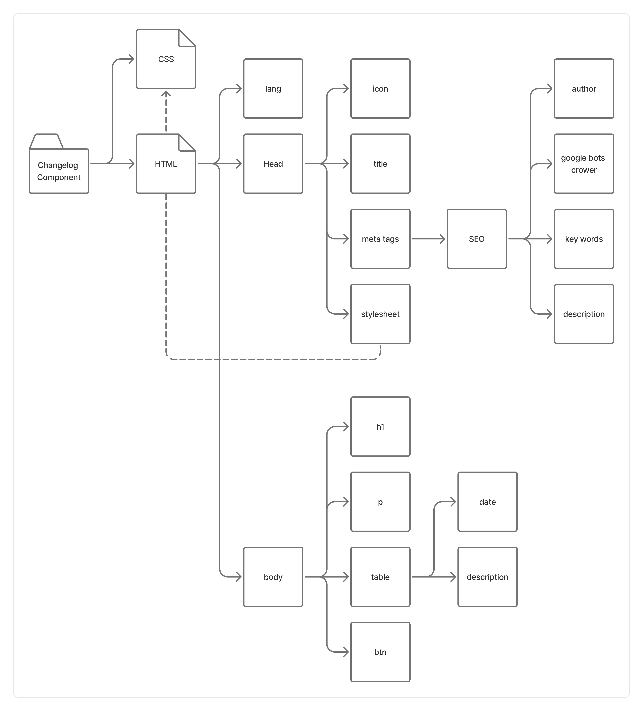

# Changelog Component

A clean, accessible, and semantic changelog component built with pure HTML & CSS.  
Designed as a reusable UI piece that displays a timeline of notable changes in a project.

> Project from [roadmap.sh](https://roadmap.sh/projects/changelog-component)

---

## Architecture & Planning

The component is structured as a vertical timeline using CSS Grid.  
Each entry consists of three main parts:

- **Date** (`<time datetime="">`)
- **Marker** (decorative line + circle)
- **Content** (description of the change)

A shared `base.css` file handles global styles and CSS custom properties, while page-specific styles live in separate files (`style.css` / `changelog_style.css`).

---

## Design Decisions

- **Semantic HTML over presentational markup**  
  Instead of using a table, the changelog is built with an ordered list (`<ol reversed>`) and the native `<time>` element. This improves accessibility, SEO, and maintainability.

- **Meaningful class names**  
  Classes describe the role of the element (`marker`, `datetime`, `content`) rather than its visual appearance (`circle`, `line`).

- **Accessibility first**  
  Decorative elements (the vertical line and circles) are marked with `aria-hidden="true"` so screen readers ignore them.

- **CSS Logical Properties & Custom Properties**  
  Used `inset-block`, `padding-inline`, and CSS variables to make the layout more flexible and direction-aware.

- **Shared base styles**  
  Common styles and design tokens are extracted into `base.css` to avoid duplication across pages.

---

## Challenges & Solutions

### Challenge: Semantic structure
Initially the changelog was implemented as a table. While it looked fine visually, it was not the correct semantic choice for a chronological list of events.

**Solution:**  
Rebuilt the component using `<ol>` + `<li>` + `<time datetime="">`. This better represents a sequence of events and improves accessibility.

### Challenge: Timeline line & markers
Creating a continuous vertical line with circular markers that stay perfectly centered and stretch correctly was the most difficult part of the layout.

**Solution:**  
- Used CSS Grid with `subgrid` for alignment  
- Drew the line and circles with pure CSS pseudo-elements (`::before` / `::after`)  
- Controlled the line height with `inset-block` so it automatically adapts to content size

### Challenge: Naming & maintainability
Early class names were based on appearance (`circle`). This would become confusing if the design changed later.

**Solution:**  
Switched to role-based naming (`marker`) and documented the reasoning for future maintainability.

---

## What I Learned

- Prefer semantic HTML elements (`<time>`, ordered lists) over generic containers
- Use meaningful class names instead of visual ones
- Mark purely decorative elements with `aria-hidden="true"`
- Leverage CSS Logical Properties and custom properties for more robust layouts
- Separate shared styles into a base stylesheet
- Build complex visual patterns (timeline) with CSS Grid + pseudo-elements without extra markup

---

## Tech Stack

- HTML5 (semantic markup)
- CSS3 (Grid, Logical Properties, Custom Properties, Pseudo-elements)
- No JavaScript / No frameworks

---

## How to view

Simply open `index.html` or `changelog.html` in any modern browser.

---

## License

This project is licensed under the MIT License.  
See the [LICENSE](LICENSE) file for details.

---

### نسخه فارسی

این پروژه یک کامپوننت ساده، تمیز و قابل استفاده مجدد برای نمایش Changelog است که فقط با HTML و CSS خالص نوشته شده.

#### معماری و ساختار

کامپوننت به صورت یک تایم‌لاین عمودی با استفاده از CSS Grid طراحی شده است. هر آیتم شامل سه بخش اصلی است:

- تاریخ (`<time datetime="">`)
- نشانگر (خط عمودی + دایره)
- محتوای تغییر

استایل‌های مشترک و متغیرهای CSS در فایل `base.css` قرار گرفته‌اند و استایل‌های مخصوص هر صفحه در فایل‌های جداگانه نوشته شده‌اند.

#### تصمیم‌های طراحی

**استفاده از Semantic HTML به‌جای ساختار ظاهری**  
در ابتدا از جدول استفاده شده بود، اما بعداً به لیست ترتیبی (`<ol reversed>`) و تگ `<time>` تغییر داده شد تا از نظر معنایی، دسترسی‌پذیری و SEO بهتر باشد.

**نام‌گذاری معنادار کلاس‌ها**  
به‌جای نام‌هایی مثل `circle` که بر اساس ظاهر هستند، از نام‌هایی مثل `marker` استفاده شده که نقش المان را توصیف می‌کنند.

**اولویت دسترسی‌پذیری**  
المان‌های تزئینی (خط و دایره‌ها) با ویژگی `aria-hidden="true"` مشخص شده‌اند تا خواننده‌های صفحه آن‌ها را نادیده بگیرند.

**استفاده از Logical Properties و Custom Properties**  
از ویژگی‌هایی مثل `inset-block` و متغیرهای CSS برای انعطاف‌پذیری بیشتر و پشتیبانی بهتر از جهت‌های مختلف متن استفاده شده است.

**جدا کردن استایل‌های پایه**  
استایل‌های مشترک در یک فایل پایه قرار گرفته‌اند تا از تکرار کد جلوگیری شود.

#### چالش‌ها و راه‌حل‌ها

**چالش ۱: ساختار معنایی**  
در ابتدا changelog به صورت جدول پیاده‌سازی شده بود. اگرچه ظاهر خوبی داشت، اما از نظر معنایی برای لیست رویدادهای زمانی مناسب نبود.

**راه‌حل:**  
ساختار به `<ol>` + `<li>` + `<time datetime="">` تغییر داده شد تا بهتر بیان‌کننده توالی رویدادها باشد و دسترسی‌پذیری را بهبود بدهد.

**چالش ۲: خط تایم‌لاین و نشانگرها**  
ساخت یک خط عمودی پیوسته همراه با دایره‌هایی که دقیقاً در مرکز قرار بگیرند و با تغییر اندازه محتوا به‌درستی کش بیایند، سخت‌ترین بخش پروژه بود.

**راه‌حل:**  
از CSS Grid همراه با `subgrid` استفاده شد. خط و دایره‌ها فقط با pseudo-elementها (`::before` و `::after`) رسم شدند و ارتفاع خط با `inset-block` کنترل شد تا به‌صورت خودکار با محتوا هماهنگ شود.

**چالش ۳: نام‌گذاری و نگهداری کد**  
نام‌های اولیه کلاس‌ها بر اساس ظاهر انتخاب شده بودند و در آینده می‌توانستند باعث سردرگمی شوند.

**راه‌حل:**  
نام‌گذاری به سمت نقش المان تغییر کرد و دلیل این انتخاب مستند شد.

#### چیزهایی که یاد گرفتم

ترجیح Semantic HTML (`<time>` و لیست‌های ترتیبی) به تگ‌های عمومی  
اهمیت نام‌گذاری کلاس‌ها بر اساس نقش، نه ظاهر  
استفاده از `aria-hidden="true"` برای المان‌های تزئینی  
کار با CSS Logical Properties و Custom Properties  
جدا کردن استایل‌های مشترک در فایل پایه  
ساخت الگوهای بصری پیچیده (مثل تایم‌لاین) فقط با CSS Grid و pseudo-element بدون HTML اضافی

---

این پروژه به‌عنوان تمرین فرانت‌اند و بخشی از رزومه ساخته شده است.

